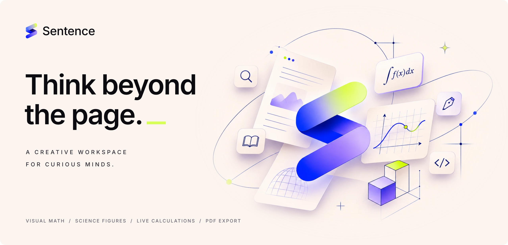
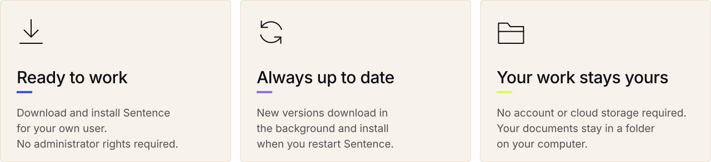
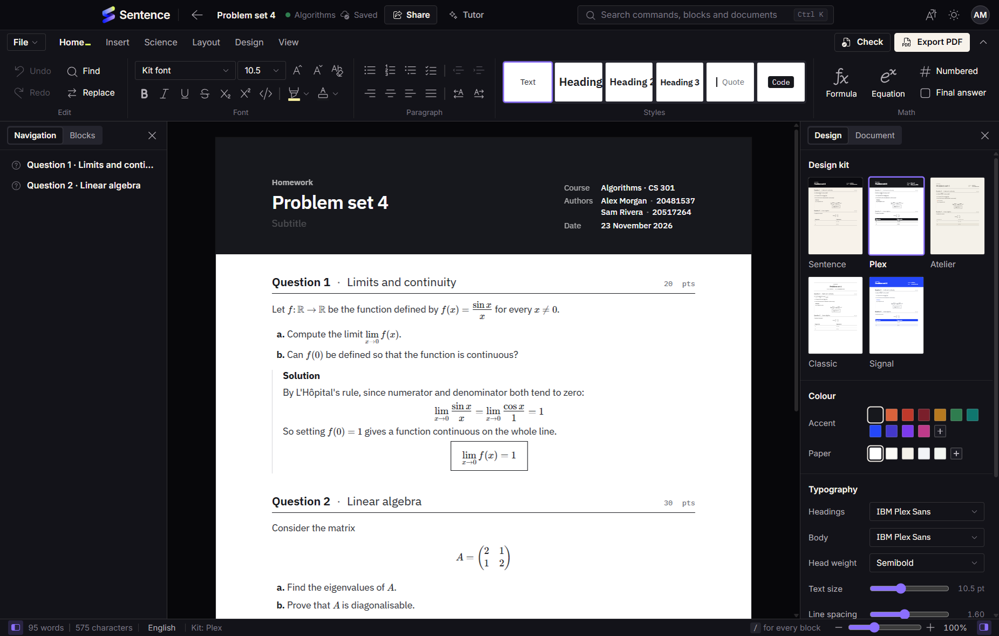
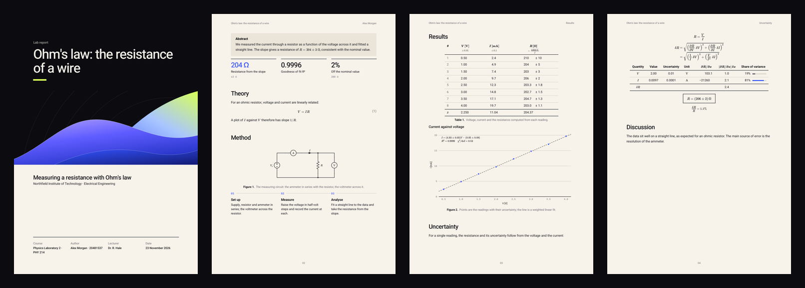

<h3 align="center">Make room for your next idea.</h3>

  

  Windows 10 and 11 (64-bit) &nbsp;&middot;&nbsp; About 130 MB &nbsp;&middot;&nbsp; <a href="https://github.com/beatskate2/open-Sentence/releases">All versions</a>

 

<picture>
  <source media="(prefers-color-scheme: dark)" srcset="assets/cards-dark.svg">
  
</picture>

  

Sentence is a creative workspace for people who want to think, learn, explore and build. It combines the precision of a professional document editor with the flexibility to work with ideas in your own way.

Create documents on real A4 pages with visual mathematics, editable scientific figures, live calculations and customizable layouts. Export your work to PDF as it appears on screen. Keep course materials, rules, tasks, grades and weekly timetables alongside your documents, and turn your own notes into revision cards, practice and study plans.

The current Windows desktop application starts with academic workflows. The broader vision is a workspace where powerful tools are accessible, complex work feels natural and ideas can grow beyond any single format or discipline.

 

## Install

1. Download `Sentence-Setup-<version>.exe` from the [latest release](https://github.com/beatskate2/open-Sentence/releases/latest).
2. Run it and choose **Install**. Sentence installs for your own user, adds a shortcut to the Start menu and the desktop, and opens when you choose **Finish**.
3. The first time, Windows may show "Windows protected your PC", because the installer is not code-signed yet. Choose **More info**, then **Run anyway**.

## Updates

Sentence checks for a new version shortly after it starts and every few hours while it is open. When there is one, it downloads in the background and a notice offers to restart now or later. You can also check yourself in **Settings**, under **About**.

## Your work

Everything you write stays on your computer, in `%APPDATA%\Sentence`. There is no account and nothing is uploaded. Uninstalling removes the app and keeps your documents and settings. To keep a copy somewhere else, **Settings**, **Data and backup** saves your documents, courses and tasks to one file.

 

Your PDF looks the way the page does on screen.

## Licence

Sentence is free to download and use for your own study and other non-commercial work. It is not open source: it may not be sold or used commercially, changed, or passed on other than by sharing this page. What you write with it is yours. The full terms are in [LICENSE](LICENSE).
